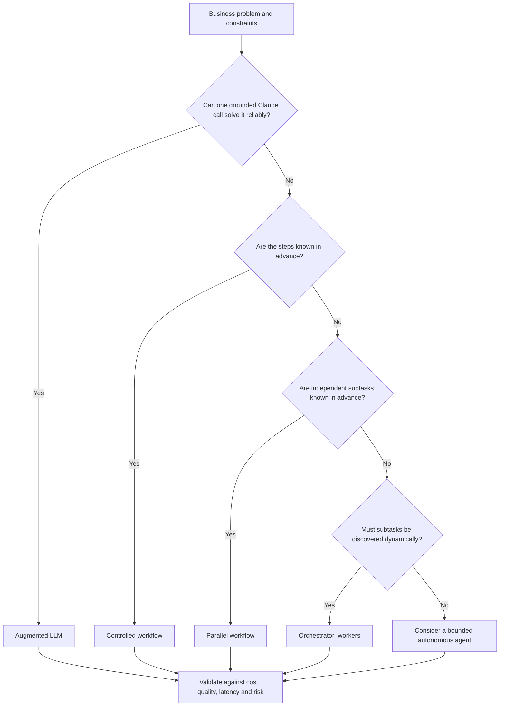
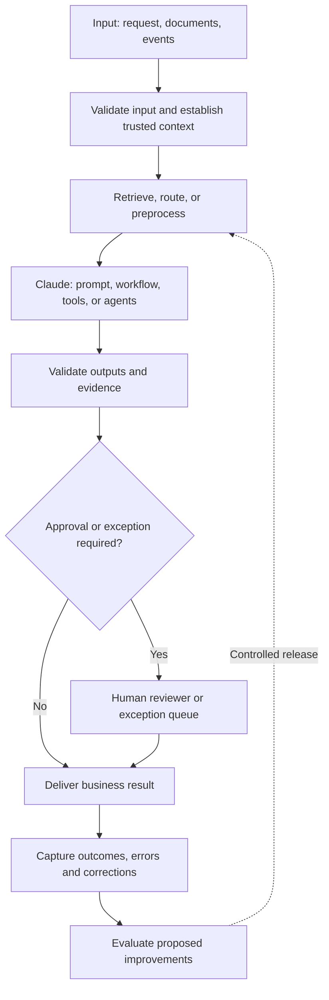
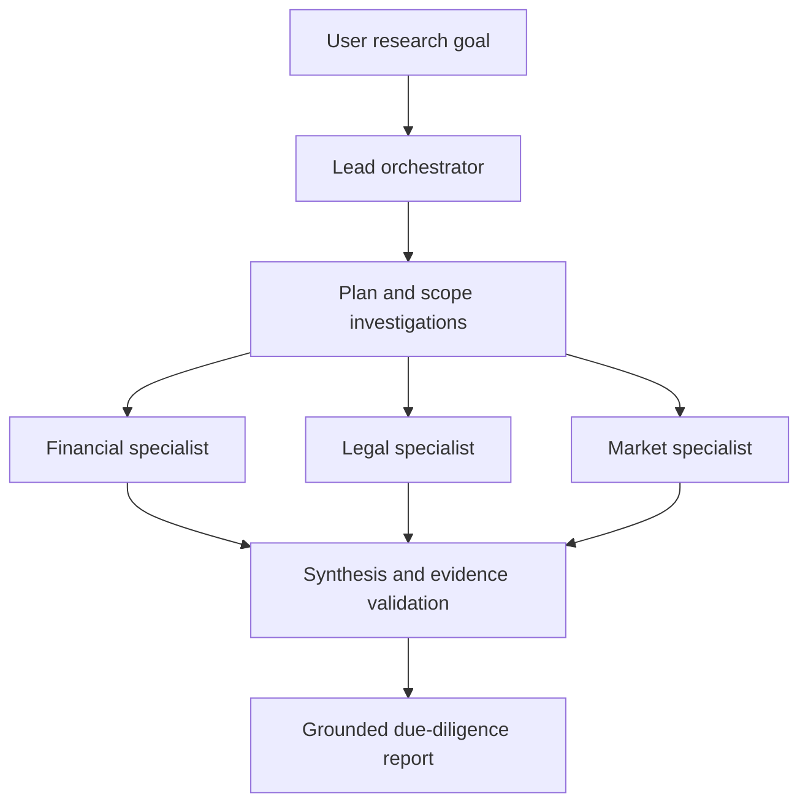
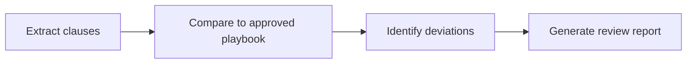
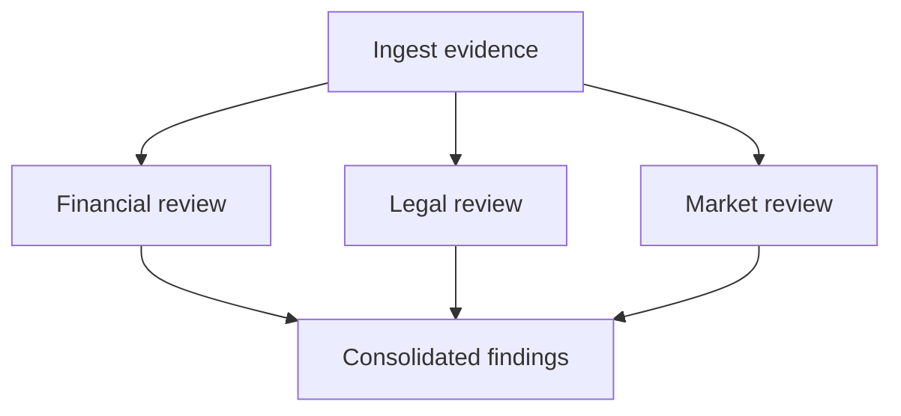
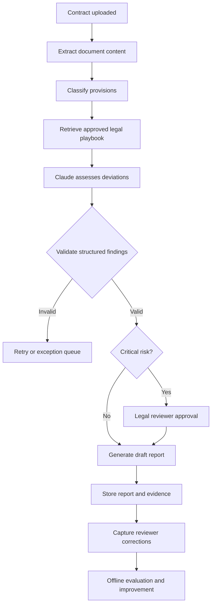

# Claude Certified Architect – Professional

## Domain 1: Solution Design & Architecture (17%)

**Blueprint scope:** July 2026 (not December 2026)  
**Focus:** Architecture selection, decision criteria, best practices, trade-offs, and scenario-based exam tasks.  
**Primary reference:** [Claude Certified Architect – Professional Exam Guide 

> **Central exam principle:** Choose the simplest architecture that satisfies the business requirements, quality constraints, risk tolerance, and operational SLAs. More autonomy or more agents do not inherently make an architecture better.

**Objectives covered**

1. Translate business problems into Claude-based AI solutions.
2. Design end-to-end architectures from input through processing, output, and feedback.
3. Select the appropriate pattern: workflow, agentic, or augmented LLM.
4. Design multi-agent systems and orchestration strategies.
5. Decompose complex problems into manageable subtasks.
6. Align designs with efficiency, transformation, productivity, cost, and performance SLAs.

---

## 1. Core Concepts

### 1.1 Translate business problems into Claude-based solutions

The solution architect's first task is to convert a business goal into a measurable system specification—not immediately to select a model or construct an agent.

**Example requirement:** “Our legal team spends three hours reviewing each vendor contract. Reduce this effort with Claude.”

| Dimension | Example requirement or decision |
|---|---|
| Business objective | Reduce manual review effort by 60%. |
| Inputs | Contracts, approved legal playbooks, standard clauses. |
| Processing | Extract clauses, compare with the playbook, identify deviations. |
| Outputs | Structured findings with evidence references and a reviewable report. |
| Quality target | High recall for critical-risk clauses; establish an acceptable false-negative rate. |
| Human oversight | Legal approval for high-impact conclusions and final dispositions. |
| Operational constraints | Throughput, cost per document, P95 turnaround, auditability. |
| Feedback | Capture reviewer corrections for offline evaluation and improvement. |

**Decision criteria:**

- What measurable business outcome defines success?
- Which actions are advisory, and which are consequential or irreversible?
- What are the accuracy, latency, throughput, cost, and availability requirements?
- What ground-truth examples and evaluation methods exist?
- Which decisions require deterministic rules or human approval?

**Exam rule:** Define success criteria and constraints before selecting the architecture.

### 1.2 Select the appropriate architectural pattern

Anthropic distinguishes **workflows** (the application controls a predetermined execution path) from **agents** (the model dynamically directs its process and tool usage). An **augmented LLM** adds facilities such as retrieval, tools, and memory without necessarily requiring a multi-step workflow.

| Pattern | Best fit | Trade-off |
|---|---|---|
| Augmented LLM | Grounded Q&A, summaries, straightforward extraction | Limited explicit orchestration |
| Prompt chaining | Known sequential subtasks | Increased cumulative latency |
| Routing | Different request types need different treatment | Misclassification can select the wrong route |
| Parallelization | Independent, known subtasks | Aggregation and coordination overhead |
| Orchestrator–workers | Subtasks vary dynamically by request | Coordination complexity and additional tokens |
| Evaluator–optimizer | Iterative refinement against usable evaluation criteria | Repeated inference and potentially variable latency |
| Autonomous agent | Open-ended planning and dynamic tool use | Less predictability, operational risk, and cost |

**Architecture-selection heuristic** (a study aid, not an official decision tree):

This diagram is a simplification. Routing, prompt chaining, parallelization, and evaluator–optimizer can be combined, and a workflow may contain bounded agentic steps.

**Exam rule:** Choose added autonomy only when it solves a real need for dynamic planning or tool selection.

### 1.3 Design an end-to-end architecture

The requested design is **input → processing → output → feedback**, with production controls around each transition.

**Production principles:**

- Validate inputs, permissions, and source data before inference.
- Separate probabilistic model judgments from deterministic policies and authorizations.
- Use structured outputs and enforce schema or business-rule checks outside the model.
- Require explicit approval for high-impact or irreversible actions.
- Define retry, fallback, timeout, and exception-handling behavior.
- Capture quality, latency, cost, failure rates, and reviewer corrections.
- Evaluate changes offline before promoting them to production.

A conversation log alone is **not** a meaningful feedback loop. The system must translate observed outcomes into measurable, governed improvements.

### 1.4 Design multi-agent systems and orchestration

Multi-agent designs are useful when work can be delegated to distinct specialists and especially when the decomposition depends on intermediate discoveries.

**Example:** M&A due diligence may require different financial, legal, regulatory, technical, and market investigations for each target.

Each worker needs:

- A bounded objective and explicit completion criteria.
- Only the tools and permissions required for that task.
- The relevant context, rather than indiscriminately copying all prior context.
- A defined output schema, evidence expectations, and error behavior.
- Limits on time, calls, tokens, and retries.

**Distinctions to know:**

- **Fixed parallel workflow:** The application already knows which tasks to launch.
- **Orchestrator–workers:** A lead coordinator chooses or creates tasks dynamically.
- **Autonomous agent:** The model controls its ongoing next-step decisions based on tool results.

Multiple Claude calls do **not** automatically constitute an agentic or multi-agent architecture.

### 1.5 Decompose complex problems

Decomposition turns broad goals into bounded, verifiable subtasks.

**Sequential decomposition** applies when one step depends on another:

**Parallel decomposition** applies when work is independent:

**Implementation concerns:**

- Define schemas and expected outputs between stages.
- Decide where validation gates belong.
- Preserve provenance for conclusions and citations.
- Anticipate partial failures and retry semantics.
- Limit shared mutable state across concurrent workers.
- Avoid parallelizing steps that rely on unresolved dependencies.

### 1.6 Align architecture with business value

The objective is not architectural sophistication: it is measurable business value under operational constraints.

| Business pillar | What to optimize | Possible metric |
|---|---|---|
| Efficiency | Less manual effort, shorter cycle time | Minutes per review |
| Transformation | Previously impractical or unavailable capabilities | Number of enabled workflows |
| Productivity | More valuable output per employee | Cases reviewed per analyst |
| Cost | End-to-end cost of a successful outcome | Cost per approved case |
| Performance SLAs | Predictable responsiveness and reliability | P95 latency, availability, error rate |

**Important distinction:** Cost per token is not necessarily cost per *successful* business outcome. A low-cost response requiring substantial reviewer rework may be more expensive end to end.

Similarly, meeting average latency does not prove compliance with a **P95** latency SLA.

---

## 2. Canonical Skeleton

### 2.1 Eight-step architecture framework

1. **Frame:** Establish business outcomes, baseline, risks, quality targets, and SLAs.
2. **Ground:** Identify sources, retrieval requirements, permissions, and integrations.
3. **Choose:** Select augmented LLM, controlled workflow, or agentic execution.
4. **Decompose:** Establish sequential and parallel subtasks with clear interfaces.
5. **Orchestrate:** Define tools, permissions, execution bounds, and error recovery.
6. **Validate:** Check structured outputs, evidence, business rules, and human approvals.
7. **Operate:** Monitor quality, latency, throughput, reliability, and cost.
8. **Improve:** Convert feedback into test cases, evaluate, and release changes through governance.

### 2.2 Architecture decision checklist

Ask these questions before selecting an exam answer:

1. Is the task sufficiently predictable to be represented as application-controlled steps?
2. Does Claude need external knowledge, tools, or both?
3. Are the subtasks predetermined or discovered dynamically?
4. Which subtasks are genuinely independent?
5. What happens if a model or tool produces an incorrect or incomplete result?
6. Which quality, latency, budget, security, and approval limits apply?
7. Is the proposed complexity justified by measurable benefits?

### 2.3 Canonical example: contract risk review

**Why this design fits:**

- The stages are mostly predictable, favoring a controlled workflow.
- Retrieval supplies current, approved playbook context.
- Claude performs semantic analysis while code enforces policy and permissions.
- Critical decisions have human approval gates.
- Corrections feed a governed evaluation process.

A multi-agent expansion becomes justifiable only when the work evolves into unpredictable, independent investigations that cannot be efficiently handled by the simpler workflow.

---

## 3. Exam Traps

| Common trap | Correct reasoning |
|---|---|
| 1. Always choose an agent for a complex problem. | Complexity alone does not require autonomy. Use an agent when dynamic planning and actions are necessary. |
| 2. More agents always improve accuracy. | More agents increase coordination, token usage, failure modes, and possibly latency. |
| 3. RAG is inherently agentic. | Retrieval-augmented generation can be a simple, non-agentic pattern. |
| 4. Using tools automatically makes a system an agent. | A fixed application workflow can call tools without transferring process control to the model. |
| 5. Parallel execution is always faster. | Independence, overhead, rate limits, aggregation, and dependencies affect performance. |
| 6. Evaluator–optimizer guarantees correctness. | Evaluators can be wrong; use testable criteria and bounded iteration. |
| 7. Use one large model for every task. | Routing, specialist handling, or deterministic logic can offer better quality and cost. |
| 8. Successful inference means the business process succeeded. | Model success is not proof of correct, approved, end-to-end business completion. |
| 9. Logging creates continuous learning. | Feedback must be curated, evaluated, and released safely. |
| 10. Optimize average latency to satisfy an SLA. | A P95 SLA requires tail-latency measurement on representative workloads. |

### High-probability distractors

**Weak answer:** Give Claude unrestricted autonomy to reduce manual effort.  
**Why it is weak:** Predictable processes, irreversible actions, and permission boundaries require controls.

**Weak answer:** Create multiple specialist agents for every extraction task.  
**Why it is weak:** A single augmented LLM or controlled pipeline may meet the requirements at lower cost and operational risk.

**Stronger answer:** Use bounded execution, explicit stage interfaces, independent validation, measurable quality gates, and human oversight where required.

---

## 4. Key Facts to Memorize

| Concept | Exam-ready fact |
|---|---|
| Workflow vs. agent | Application code controls a workflow; the model dynamically controls an agent's decisions. |
| Augmented LLM | An LLM enhanced with capabilities such as retrieval, tools, or memory. |
| Prompt chaining | Fixed sequence of model tasks with intermediate outputs or checks. |
| Routing | Classify a request and dispatch it to the appropriate branch. |
| Parallelization | Run independent, known subtasks concurrently. |
| Orchestrator–workers | Coordinator dynamically identifies and delegates subtasks. |
| Evaluator–optimizer | Generate, evaluate, and revise against explicit criteria. |
| Multi-agent overhead | More coordination, context management, inference and operational complexity. |
| Feedback loop | Capture outcomes, evaluate mistakes, and safely improve the system. |
| Business value | Optimize measurable outcomes, not model or agent count. |

### Three distinctions to master

**A. Workflow vs. agent:** A workflow follows an application-defined process; an agent chooses steps as it proceeds.

**B. Parallelization vs. orchestrator–workers:** Ordinary parallelism follows a predefined task list; an orchestrator discovers task assignments dynamically.

**C. Latency vs. total cost:** Parallelism may shorten elapsed time even if it increases total consumption and coordination overhead.

A simple performance intuition is:

\[
T_{\text{sequential}} \approx \sum_{i=1}^{n} T_i
\]

\[
T_{\text{parallel}} \approx \max(T_1,\ldots,T_n)+T_{\text{overhead}}
\]

These are explanatory engineering approximations, **not official exam formulas**. Real behavior also depends on rate limits, queueing, retries, and dependencies.

---

## 5. Five Exam-Style Questions, Answers, and Explanations

> These are **original practice questions**, not actual exam questions. Select the **best** option unless otherwise specified.

### Question 1 — Translate business requirements

**Difficulty:** Moderate

A multinational company's procurement director wants Claude to reduce vendor contract-review effort by 70%. The team has 400 sample contracts but has not established accuracy requirements or defined which decisions require legal approval.

**What should the solution architect do FIRST?**

A. Select the most capable Claude model and build an autonomous contract-review agent.  
B. Define measurable business outcomes, error tolerance, approval requirements, representative test cases, and operational constraints.  
C. Create four specialist agents for extraction, risk analysis, compliance, and reporting.  
D. Fine-tune the solution on all 400 contracts before establishing quality metrics.

**Correct answer: B**

**Explanation:** Architecture follows business outcomes and risk boundaries. Establish the baseline, target quality, permitted automation, representative evaluations, available evidence, and SLAs before deciding on model, workflow, or agents.

**Why the distractors are wrong:**

- **A:** Prematurely chooses both the model and autonomy level.
- **C:** Introduces distributed complexity without evidence of need.
- **D:** Chooses a training technique before defining the problem and evaluation method.

**Exam takeaway:** Begin with measurable requirements, not model or agent selection.

### Question 2 — Select the appropriate workflow

**Difficulty:** Moderate

An insurer processes claims using five known steps: document classification, information extraction, policy lookup, eligibility checking, and draft decision generation. Payment approval is restricted to authorized staff. Stages must remain auditable and predictable.

**Which design is MOST appropriate?**

A. A fully autonomous agent that chooses every processing step and can authorize payments.  
B. A deterministic workflow using Claude for semantic subtasks, explicit validation between stages, and human approval for payment.  
C. An unrestricted orchestrator that dynamically creates new specialist agents for every claim.  
D. One large Claude prompt that performs extraction, eligibility checking, authorization, and payment without intermediate checks.

**Correct answer: B**

**Explanation:** This is a known business process. Keep orchestration under application control, use Claude where language understanding is needed, and enforce checks and approval outside the model. This meets predictability, auditability, and authorization requirements.

**Why the distractors are wrong:**

- **A:** Unnecessary autonomy and an inappropriate authorization boundary.
- **C:** Dynamic orchestration is not needed for a fixed procedure.
- **D:** Collapses validation, decision support, and authorization into a single model interaction.

**Exam takeaway:** Predictable process + controlled risk = deterministic workflow.

### Question 3 — Multi-agent orchestration

**Difficulty:** Hard

An investment research platform investigates potential acquisition targets. Each target requires a different combination of financial, regulatory, technical, legal, and market investigations. The relevant subtasks cannot reliably be decided before reviewing initial evidence. The final report must consolidate findings and sources.

**Which architecture BEST fits?**

A. A fixed prompt chain that runs the same five analysis stages for every target.  
B. A single retrieval-augmented question-answering call with no task planning.  
C. An orchestrator–workers system that identifies necessary investigations, assigns bounded specialist tasks, then synthesizes and validates results.  
D. Five independent workers using a predefined checklist without coordinating synthesis.

**Correct answer: C**

**Explanation:** Task decomposition is dynamic. A lead orchestrator should determine which investigations are needed and delegate bounded work to specialists, then merge results, resolve inconsistencies, and validate source support.

**Why the distractors are wrong:**

- **A:** Fixed stages cannot adapt efficiently to changing investigation scope.
- **B:** A single call is poorly suited to extended, multi-step investigation.
- **D:** Fixed parallel work does not provide dynamic assignment or coherent synthesis.

**Exam takeaway:** Unpredictable decomposition + specialist research = orchestrator–workers.

### Question 4 — Architecture under performance constraints

**Difficulty:** Hard

An internal HR assistant answers 2,000 daily policy questions. Policies are maintained centrally, most questions need only one lookup, and the application has a P95 latency target of two seconds. Accuracy and traceable sources are mandatory.

**What is the BEST initial architecture to evaluate?**

A. A single retrieval-augmented Claude interaction using relevant policy passages, citations, and validation, benchmarked against the P95 SLA.  
B. A five-agent system that independently searches and debates every policy question.  
C. An autonomous agent that repeatedly searches until it decides the answer is sufficiently complete.  
D. A long sequential chain that sends every question through five model-based review stages.

**Correct answer: A**

**Explanation:** Most requests fit a simple grounded-response architecture. A bounded retrieval-plus-generation path is easier to optimize, validate, and trace. The two-second P95 must still be tested against realistic loads; it is not guaranteed by selecting this pattern.

**Why the distractors are wrong:**

- **B:** Adds excessive coordination for routine lookup tasks.
- **C:** Creates unbounded latency variability.
- **D:** Adds serial model calls without a clear quality benefit.

**Exam takeaway:** For routine grounded Q&A with strict latency, evaluate the simplest retrieval-augmented design first.

### Question 5 — End-to-end design and feedback

**Difficulty:** Hard — **Select TWO answers**

A Claude-powered contract-analysis workflow meets its average latency target but sometimes misses critical clauses. Reviewers regularly correct reports. Leadership wants the system to improve without creating unapproved changes to production decisions.

**Which TWO architectural changes are MOST appropriate?**

A. Capture structured reviewer corrections with source references and link them to the original model outputs.  
B. Allow the model to rewrite production instructions immediately after each negative reviewer comment.  
C. Increase the number of autonomous agents without first diagnosing the errors.  
D. Create a versioned evaluation dataset from reviewed examples and test candidate changes before rollout.  
E. Measure only average response latency because the workflow already meets its performance target.

**Correct answers: A and D**

**Explanation:** Reviewer corrections create usable quality signals if they are structured and linked to the source evidence. A versioned evaluation dataset supports controlled comparison of prompt, retrieval, and workflow changes before release. This is a governed feedback loop.

**Why the distractors are wrong:**

- **B:** Allows unreviewed production changes that can introduce new failures.
- **C:** Expands architecture without identifying the cause of clause misses.
- **E:** Ignores quality and does not assess tail-latency commitments.

**Exam takeaway:** Feedback becomes useful when converted into validated evaluations and controlled releases.

### Answer key

| Question | Correct answer | Core concept |
|---|---|---|
| 1 | **B** | Requirements first |
| 2 | **B** | Controlled workflow for known stages |
| 3 | **C** | Dynamic orchestrator–workers decomposition |
| 4 | **A** | Simplicity, grounded retrieval, P95 validation |
| 5 | **A + D** | Governed feedback and evaluation |

---

## 6. Final Revision Sheet

| If the scenario says… | Prefer to consider… |
|---|---|
| Known and repeatable processing stages | Deterministic workflow |
| Unpredictable next steps and tool use | Bounded autonomous agent |
| Unpredictable specialist task decomposition | Orchestrator–workers |
| Independent, predefined tasks | Parallelization |
| Different classes of user requests | Routing |
| Repeatable refinement against criteria | Evaluator–optimizer |
| Internal knowledge required | Retrieval-augmented LLM |
| High-impact or irreversible actions | Explicit authorization and human approval |
| Strict latency SLAs | Minimize critical-path work; measure P95 |
| Business sponsor requests transformation | Establish baseline, measurable outcomes, total cost, and risk |

### High-value study sequence

1. Memorize **workflow vs. agent** and **fixed parallelism vs. dynamic orchestration**.
2. Study all five foundational workflow patterns: prompt chaining, routing, parallelization, orchestrator–workers, and evaluator–optimizer.
3. Practice identifying whether the **application** or the **model** owns execution control.
4. For each scenario, state one decisive reason to prefer the simplest adequate design.
5. Validate every architecture against business value, quality, cost, operational risk, and P95 latency where applicable.

### Recommended primary reading (published before July 2026)

1. [Anthropic — Building Effective Agents](https://www.anthropic.com/research/building-effective-agents) — Foundational workflow and agent patterns.
2. [Anthropic — How We Built Our Multi-Agent Research System](https://www.anthropic.com/research/multi-agent-research-system) — Dynamic delegation, specialist workers, and synthesis.
3. [Anthropic — Effective Context Engineering for AI Agents](https://www.anthropic.com/research/effective-context-engineering-for-ai-agents) — Context management and delegation discipline.

---

## Final takeaway

**Domain 1 evaluates architectural judgment rather than the ability to propose the most sophisticated system.** For each scenario, explain:

- **Why** the selected pattern matches the task structure.
- **Why** a simpler architecture is or is not sufficient.
- **How** the system controls failure, permissions, and consequential actions.
- **How** its quality, cost, and SLA performance will be measured.
- **How** feedback produces reliable, governed improvements.

*Scope note: This guide uses the July 2026 Domain 1 objectives supplied with the reference guide and excludes later examination revisions. The questions, frameworks, and decision heuristics are original study material, not official Anthropic exam items.*
